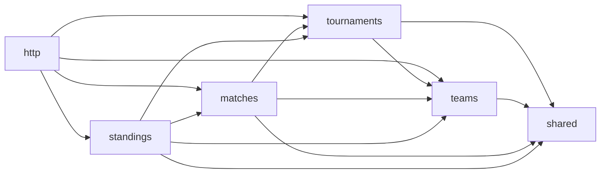
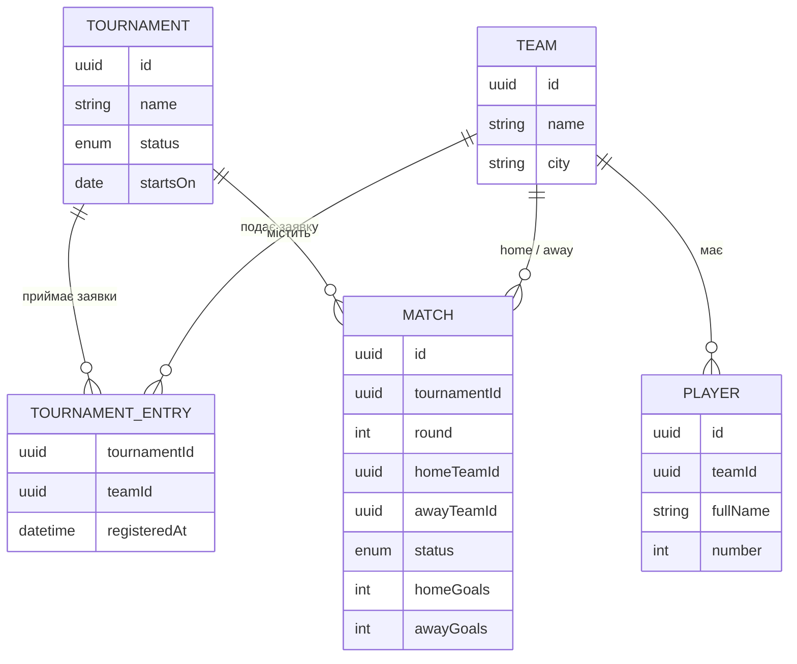

# Spec — Tournament Planner (Завдання 1: фундамент і структура)

## 1. Намір

Організатор аматорського футбольного турніру має вести турнір без ручних таблиць. Він реєструє
команди, отримує розклад «кожен з кожним» і вносить рахунки, а турнірна таблиця завжди
актуальна. Завдання 1 закладає структуру модулів і межі між ними. Бізнес-логіку
наповнюють завдання 2+.

## 2. Поза обсягом (ітерація 1)

- БД і персистентність: це завдання 2, тут лише контракти репозиторіїв.
- Автентифікація, ролі: курс цього не вимагає, тож відкладено.
- Плей-оф, групи, UI: зайве для MVP.
- Заморожування складу команди під час турніру: склад змінюється будь-коли. Інакше `teams`
  мав би залежати від `tournaments`, що порушує D4.

## 3. Модулі та взаємодія

| Модуль        | Відповідальність                                      |
| ------------- | ----------------------------------------------------- |
| `tournaments` | турнір, його статус, реєстрація команд (заявки)       |
| `teams`       | команди та гравці                                     |
| `matches`     | генерація розкладу, внесення результатів              |
| `standings`   | обчислення турнірної таблиці з завершених матчів      |
| `shared`      | спільні типи: помилки домену, ідентифікатори          |
| `http`        | Express-застосунок: маршрути модулів, обробка помилок |
| `config`      | читання змінних середовища                            |

`standings → tournaments`: у таблиці мають бути всі заявлені команди, зокрема ті, що ще не
зіграли жодного матчу, а перелік заявок належить `tournaments`.

## 4. Дані та зв'язки

Інваріанти:

- `TOURNAMENT.status`: `registration` → `in_progress` → `finished`, тільки вперед.
- Одна заявка на пару (турнір, команда). Команда не грає сама з собою.
- Номер гравця унікальний у межах команди.
- Турнірна таблиця **не зберігається**, вона похідна від `MATCH`.

## 5. Ключові сценарії (як змінюються дані)

1. **S1. Заявка команди.** Статус турніру `registration` → створюється `TOURNAMENT_ENTRY`.
2. **S2. Старт турніру.** Потрібно ≥ 2 заявок. Створюється N·(N−1)/2 записів `MATCH` (кругова
   система), статус турніру стає `in_progress`. Після цього заявки заморожено.
3. **S3. Результат матчу.** `MATCH.status` змінюється з `scheduled` на `finished`, записуються
   голи. Таблиця зміниться при наступному читанні.
4. **S4. Таблиця.** Рахується з `finished`-матчів: перемога 3, нічия 1, поразка 0. Сортування:
   очки → різниця м'ячів → забиті → назва.
5. **S5. Завершення.** Коли всі матчі `finished`, статус турніру стає `finished`.

## 6. Правила залежностей (перевіряє `npm run audit:deps`)

- **D1.** Немає циклічних залежностей.
- **D2.** Модуль імпортує інший модуль лише через його `index.ts` (публічний API). Дані
  іншого модуля читаються лише через його **сервіс** (`TeamsService`, …). Репозиторій
  (`*Repository`) — приватна деталь свого модуля: його не передають в інші модулі.
- **D3.** Доменний код (`*.service.ts`, `*.domain.ts`) не імпортує `express`.
- **D4.** Напрям залежностей між модулями — тільки за графом §3. `teams` — листовий модуль: він
  не залежить від жодного іншого доменного модуля. Ребро, якого немає в графі, спершу
  додається в spec з обґрунтуванням.
- **D5.** `shared` — ядро без залежностей: не імпортує `express` (і жоден інший фреймворк) та
  не залежить від `modules/`, `http/`, `config/`. Мапінг помилок домену на HTTP-статуси
  належить шару `http`.

## 7. Критерії прийняття

- **AC1.** `npm run check` проходить на чистому клоні.
- **AC2.** `GET /health` → `200 {"status":"ok"}` (smoke-тест).
- **AC3.** Кожен модуль з §3 — це тека `src/modules/<name>/` з `index.ts`.
- **AC4.** Правила D\* виконуються автоматично в pre-push.
- **AC5.** Hook блокує коміт з неформатованим кодом або помилкою лінтера.
- **AC6.** Генерація розкладу (S2) і таблиця (S4) — чисті функції без I/O.
